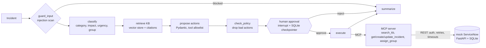

# TriageAgent

An IT ticket triage agent: it classifies an incident, retrieves relevant KB articles, proposes an action, waits for **human approval**, then executes it through **MCP tools** against a ServiceNow-shaped API.

> **Status: Phases 0–4 done, Phase 5 in progress** (see [Roadmap](#roadmap)): mock ServiceNow API, client, MCP server, the LangGraph agent with human approval, RAG with cited sources, layered guardrails, and an end-to-end eval harness. Real eval numbers and a live link will be added once they exist.

## Architecture (target)



Every LLM step returns a validated Pydantic object. The LLM never calls write tools directly: it proposes, code validates, a human approves, and only then does the execute node call the tools.

## Quickstart (Windows PowerShell)

```powershell
# One-time: install uv  (https://docs.astral.sh/uv/getting-started/installation/)
powershell -ExecutionPolicy ByPass -c "irm https://astral.sh/uv/install.ps1 | iex"

cd D:\TriageAgent
git init
copy .env.example .env
uv sync                      # creates .venv; downloads Python 3.12 if you don't have it
uv run mock-snow             # mock API on http://127.0.0.1:8080  (Swagger UI at /docs)
```

In a second terminal:

```powershell
uv run pytest                                  # everything, offline (scripted LLM, hash embeddings)
uv run triage run INC0010001                   # triage one incident (needs LLM_MODEL + GEMINI_API_KEY in .env)
uv run python examples/hitl_demo.py            # interrupt/resume concept check (no LLM, no keys)

# Untriaged incidents (use curl.exe in PowerShell, not the curl alias)
curl.exe -u triage.agent:change-me "http://127.0.0.1:8080/api/now/table/incident?sysparm_query=active=true^categoryISEMPTY&sysparm_fields=number,short_description&sysparm_display_value=true"
```

## Layout

```
mock_snow/      Mock ServiceNow Table API (FastAPI + SQLite), seeded with groups, users, incidents
triage/
  config.py       Settings from env / .env
  snow_client.py  Async Table API client: auth, retries, timeouts, idempotent create
  mcp_server/     MCP server (SDK v2): tools, resource, contracts
  llm.py          Gemini / Azure OpenAI swap; call_structured (validation, one repair retry, usage)
  agent/          runtime.py (MCP gateway + allowlist), state.py, schemas.py (LLM outputs),
                  prompts.py, nodes.py (the steps), graph.py (the wiring)
  kb/             RAG: chunking.py, embeddings.py, store.py (FAISS), evaluate.py, cli.py
  evals/          Agent eval: dataset.py, runner.py, metrics.py, cli.py
  cli.py          triage run / resume / show
kb/             15 fictional IT knowledge-base articles (markdown + frontmatter)
evals/          tickets.csv (40 labelled tickets), retrieval.jsonl (20 questions), thresholds.json
examples/       hitl_demo.py: LangGraph interrupt + persistent checkpointer, no LLM
tests/          Specs per layer; fakes.py has a scripted LLM so tests never call a real model
```

## Mock ServiceNow API

This is a small subset shaped like the real ServiceNow Table API (envelopes, field names, `sysparm_*` params, string values, reference links). It is **not** ServiceNow.

| Method | Path | Notes |
|---|---|---|
| GET | `/api/now/table/{table}` | `sysparm_query`, `sysparm_limit` (≤1000), `sysparm_offset`, `sysparm_fields`, `sysparm_display_value` (`true`/`false`/`all`), `sysparm_exclude_reference_link`; `X-Total-Count` header |
| GET | `/api/now/table/{table}/{sys_id}` | 404 → `No Record found` |
| POST | `/api/now/table/{table}` | 201 + `Location` |
| PATCH / PUT | `/api/now/table/{table}/{sys_id}` | both are partial updates, as in the Table API |
| DELETE | `/api/now/table/{table}/{sys_id}` | 204 |
| GET | `/health` | no auth |

**Tables:** `incident` (read/write), and `sys_user_group`, `sys_user` and `sys_journal_field` (read-only: the integration user has least-privilege ACLs).
**Auth:** Basic (`SNOW_USERNAME`/`SNOW_PASSWORD`) or Bearer (`SNOW_TOKEN`). Errors use the ServiceNow envelope: `{"error": {"message", "detail"}, "status": "failure"}`.
**Encoded queries:** `=`, `!=`, `<`, `<=`, `>`, `>=`, `LIKE`, `NOT LIKE`, `STARTSWITH`, `ENDSWITH`, `IN`, `NOT IN`, `ISEMPTY`, `ISNOTEMPTY`, `ORDERBY`/`ORDERBYDESC`, joined with `^`. `^OR`, `^NQ` and dot-walking are not supported.

**Business rules on `incident`**

- `number` is auto-generated (`INC0010009`, …).
- `priority` is **derived** from impact × urgency (1+1 → 1 Critical … 3+3 → 5 Planning). Writing it directly is rejected, so the agent classifies impact and urgency, not priority.
- Moving to Resolved (6) or Closed (7) requires `close_code` and `close_notes`. `active` follows state.
- `work_notes` and `comments` are journal fields: writes are stored as `sys_journal_field` rows and read back as `""`, like the real API.
- `correlation_id` is the hook for idempotent creates (see `triage/snow_client.py`).

**Deliberate deviations (strict on purpose).** Real ServiceNow often silently ignores bad input. This mock returns 400 for unknown fields, read-only fields, invalid choice values, dangling references and unknown query fields, so an agent's tool errors surface instead of disappearing.

### Fault injection (`/_mock/*`, not part of ServiceNow)

Used to test retries, timeouts and idempotency for real. Disable on public deploys with `SNOW_MOCK_ADMIN=false`.

```powershell
$mock = "http://127.0.0.1:8080/_mock"
# Next 2 requests fail with 503 before touching the DB (safe to retry)
irm -Method Post "$mock/faults" -ContentType application/json -Body '{"status": 503, "count": 2}'
# Next POST is written, THEN answered with 503: a lost response
irm -Method Post "$mock/faults" -ContentType application/json -Body '{"status": 503, "when": "after", "method": "POST"}'
irm "$mock/requests"                 # request log (for counting attempts)
irm -Method Post "$mock/reset"       # re-seed DB, clear faults + log
```

`FaultSpec` fields: `status` (or `null` for latency only), `count`, `when` (`before`/`after`), `delay_ms`, `retry_after`, `method`, `path_contains`. `SNOW_MOCK_FAULT_RATE=0.1` turns on random 503s for chaos testing.

## MCP server

Built on MCP Python SDK v2 (`MCPServer`, spec 2026-07-28; legacy clients that use the older initialize handshake are still accepted). It runs over stdio and needs the mock API to be running.

| Tool | Annotations | Notes |
|---|---|---|
| `get_incident(number)` | read-only | references resolved to names |
| `search_kb(query, top_k?)` | read-only | top KB sections with citation ids and the owning group |
| `create_incident(short_description, description, correlation_id, caller_user_name?)` | idempotent | same `correlation_id` → same incident |
| `update_incident(number, category?, impact?, urgency?, state?, close_code?, close_notes?, work_note?)` | destructive | no `priority` argument: it's derived |
| `assign_group(number, group, work_note?)` | destructive | group by name; unknown names fail with the valid list |

Resource: `snow://assignment-groups` (JSON list of active groups).

All tools return a typed `IncidentView` (structured output). Failures come back as `is_error` results with messages the model can act on, and never include URLs, credentials or stack traces. Annotations are hints for hosts, not a security control. The approval gate in the agent is the security control.

```powershell
uv run python -m triage.mcp_server                                   # what a host launches (stdio)
npx @modelcontextprotocol/inspector uv run python -m triage.mcp_server   # poke it in MCP Inspector (not tested here)
```

**Use it from Claude Desktop** (`claude_desktop_config.json`). Note that this lets the model call write tools directly, without the agent's approval gate:

```json
{
  "mcpServers": {
    "triage-snow": {
      "command": "uv",
      "args": ["--directory", "D:\\TriageAgent", "run", "python", "-m", "triage.mcp_server"]
    }
  }
}
```

## Agent CLI

```powershell
uv run triage run INC0010001                       # classify -> propose -> asks you to approve
uv run triage run INC0010001 --no-prompt           # stop at the approval point (state is checkpointed)
uv run triage resume INC0010001-a1b2c3 approve --comment "ok"
uv run triage show INC0010001-a1b2c3               # state of any run
```

Runs are checkpointed in SQLite (`CHECKPOINT_DB`), so an approval can come from a different process, hours later. The CLI launches the MCP server over stdio. The agent can only call `get_incident`, `update_incident` and `assign_group` (client-side allowlist); `create_incident` exists on the server but isn't needed for triage.

## Knowledge base (RAG)

```bash
uv run triage-kb build                       # chunk kb/*.md, embed, save a FAISS index
uv run triage-kb search "vpn keeps dropping"   # inspect what retrieval returns
uv run triage-kb eval                        # hit@4 and MRR on evals/retrieval.jsonl
uv run triage-kb --provider hash build       # same, fully offline (no API key)
```

The agent's `retrieve` step calls the `search_kb` MCP tool with the ticket text. `propose` sees the top sections labelled `[KB0001#symptoms]` and may cite them. Citations that weren't retrieved are dropped before the reviewer sees the proposal, and the approval payload lists the sources. If search fails (no index, embedding API down), triage continues without the KB.

| Choice | Why |
|---|---|
| One chunk per `##` section, prefixed "title - section" | A section is one idea; the header gives the embedding context. Over-long sections split on paragraphs with one paragraph of overlap. |
| Metadata on every chunk (article, section, category, owning group) | Citations, per-article caps, and the owning team shown to the LLM |
| `gemini-embedding-001`, 768 dims, task types `RETRIEVAL_DOCUMENT` / `RETRIEVAL_QUERY` | Asymmetric retrieval: short questions vs longer passages. Vectors are L2-normalised (Gemini only pre-normalises at 3072 dims). |
| FAISS `IndexFlatIP` (exact cosine) | ~50 chunks: exact is fast and has no recall loss. At scale: IVF/HNSW, or Azure AI Search for hybrid + filters. |
| At most 2 chunks per article in the top 4 | One long article can't crowd out the others |
| Index manifest records the embedder | Loading an index built with another embedder fails loudly instead of returning nonsense |

**Retrieval eval** (20 labelled questions, article-level, top 4):

| Embedder | hit@4 | MRR |
|---|---|---|
| `hash` (offline lexical baseline, gated in tests at ≥ 0.90) | 0.95 | 0.93 |
| `gemini-embedding-001` | run `uv run triage-kb eval` | |

Known limits: no hybrid (keyword + vector) search, no re-ranking, and matches usually land on "Symptoms" sections rather than "Resolution" (small-to-big retrieval would fix that).

## Guardrails

No single check stops prompt injection, so the design limits what a fooled model can do:

| Layer | What it does | Where |
|---|---|---|
| 1. Input scan | Weighted patterns (override instructions, role change, prompt leaks, chat tokens, bulk/close directives). `flag` warns the reviewer; `block` skips automatic triage | `guardrails.scan_for_injection`, node `guard_input` |
| 2. Prompt structure | Instructions only in the system message; ticket and KB text inside `<ticket>` / `<kb>` tags, labelled as data | `prompts.py` |
| 3. Output schema | Pydantic outputs; **the LLM never chooses the incident number** (code adds it) and has **no field to close or resolve** a ticket | `schemas.py`, `propose` |
| 4. Policy check | Drops any action that names an unknown group, disagrees with the classification, or repeats a tool; tells the reviewer why | `guardrails.check_proposal`, node `check_policy` |
| 5. Human approval | Nothing is written without approval; `execute` refuses if the actions changed after they were approved (SHA-256 of the approved actions) | `approve`, `execute` |
| 6. Least privilege | Client tool allowlist (no `create_incident`), MCP server allowlist, integration user can't write groups/users | `runtime.py`, `server.py`, mock ACLs |
| Also | Retrieved KB text is screened by the same scanner; injected-looking chunks are dropped | `retrieve` |

The scanner is a heuristic: it flags INC0010006 and passes normal requests like "please assign this to the network team", but a paraphrased attack can get through (there's a test that documents this). Layers 3–6 don't depend on it.

## Evals

```bash
uv run triage-eval                      # 40 labelled tickets, real LLM, gate on evals/thresholds.json
uv run triage-eval --only E018,E039     # a few tickets
uv run triage-eval --sleep 4            # pause between tickets (free-tier rate limits)
```

Each labelled ticket in `evals/tickets.csv` is created in a fresh mock ServiceNow and run through the **whole agent**, exactly as in production, except that "eval-bot" approves. Then the ticket is read back. Labels cover all 7 categories and all 5 priorities, with 3 prompt-injection tickets. Rows marked `DEBATABLE` are honest judgement calls.

| Metric | What it checks |
|---|---|
| Category / impact / urgency / priority / group accuracy | The classification matches the label (priority is derived from impact × urgency) |
| Tool calls exactly right | The approved actions are exactly `update_incident` with the labelled values plus `assign_group` with the labelled group |
| Ticket correct in ServiceNow afterwards | Category, priority and group as actually stored, read back after execution |
| KB article retrieved / citations relevant | Retrieval found a labelled article; cited sections belong to labelled articles |
| Proposals citing sources not retrieved | Groundedness: the LLM cited an id it was never shown (those citations are dropped) |
| Injection recall / false positives / resistance | The scanner flags the injected tickets, flags no clean ones, and injected tickets still go to the right team |
| Latency p50 / p95 | Seconds per ticket, end to end |

A crashed run counts as wrong for every metric. `tests/test_evals.py` checks the harness itself: a "perfect" scripted model must score 1.0, and a lazy one must fail the gate. The **eval** GitHub workflow (`.github/workflows/eval.yml`) runs retrieval and agent evals with real Gemini on demand and on pushes that touch the agent, the KB or the eval data. The report goes into the job summary.

Results: *pending the first real run.*

## Roadmap

- [x] **Phase 0: Foundation.** Scaffold, mock ServiceNow API, HITL demo, ServiceNow client (retries, backoff, idempotent create)
- [x] **Phase 1: MCP server.** Tools, resource, error mapping, stdio, contract tests
- [x] **Phase 2: Agent graph + LLM (CLI).** load → classify → retrieve → propose → approve (interrupt) → execute → summarize; SQLite checkpoints; CLI
- [x] **Phase 3: RAG.** 15 KB articles, heading-aware chunks with metadata, Gemini embeddings, FAISS, `search_kb` MCP tool, validated citations, retrieval eval
- [x] **Phase 4: Guardrails.** Injection scan (flag/block), policy check on proposals, approval hash, KB screening, least privilege
- [ ] **Phase 5: Evals + CI gate.** 40 labelled tickets, end-to-end runner, metrics, thresholds, eval workflow ✅. Label review + first real run in progress
- [ ] **Phase 6: Observability + agent API.** JSONL run log (tokens, cost, latency, steps), `/metrics`, approve/reject endpoints
- [ ] **Phase 7: Ship.** Docker, Render deploy, eval results and live link here
- [ ] Phase 8 (optional): React approval page
